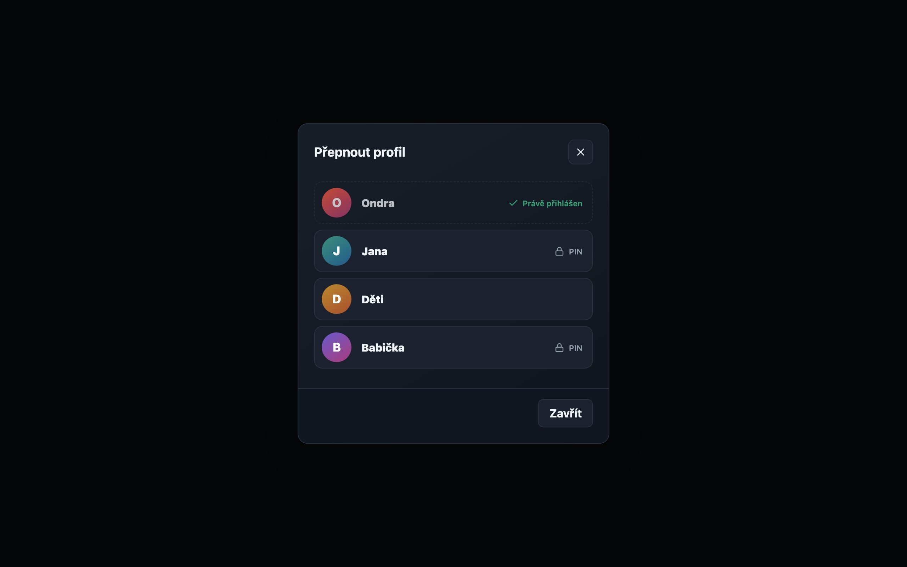
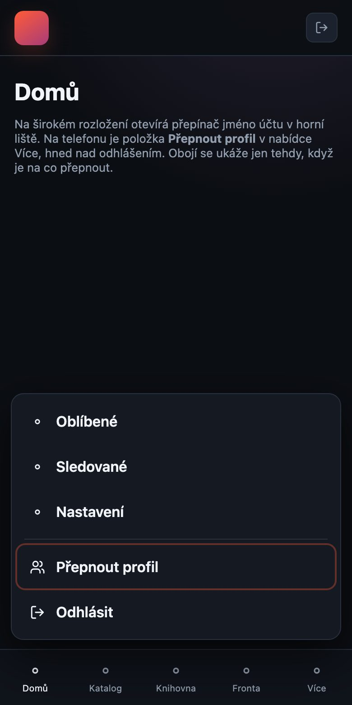
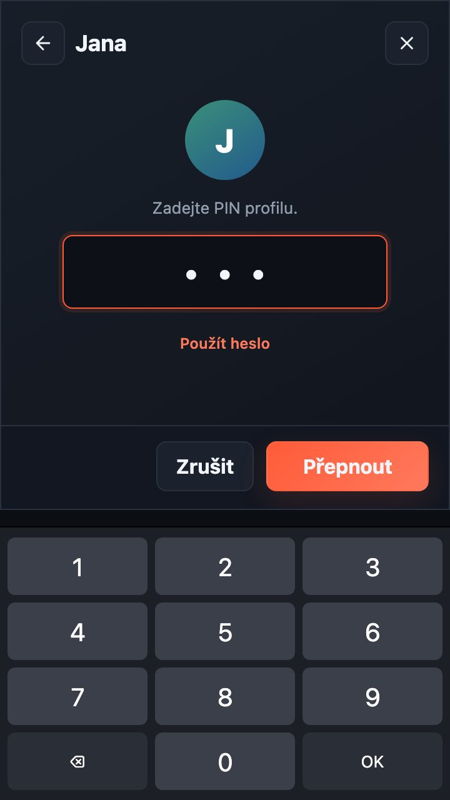
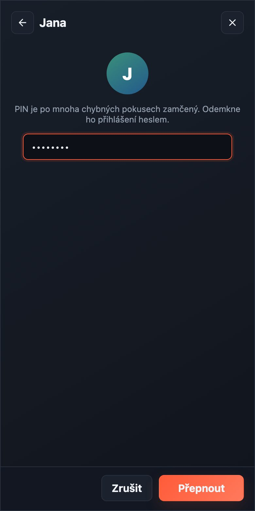
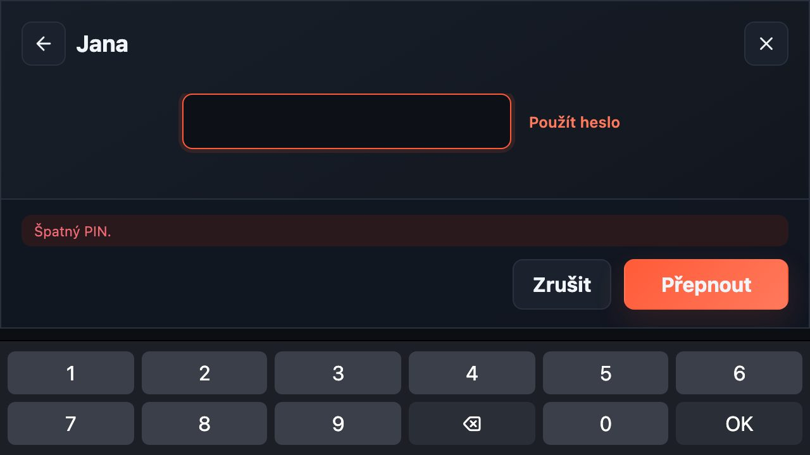
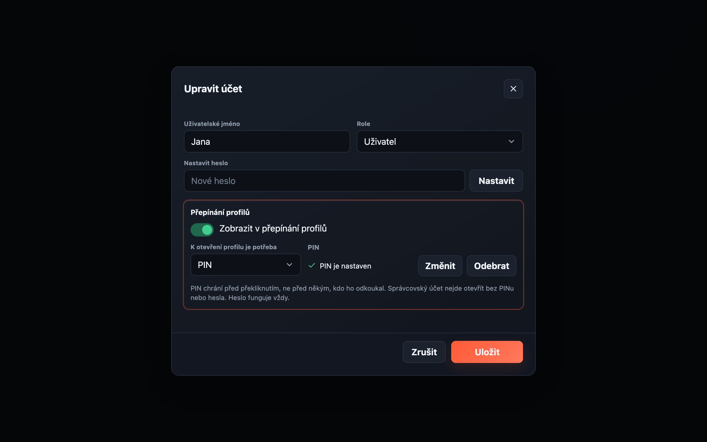
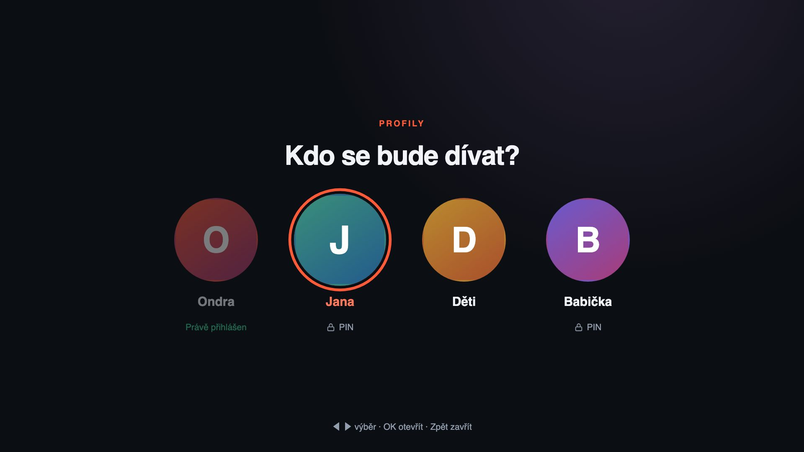
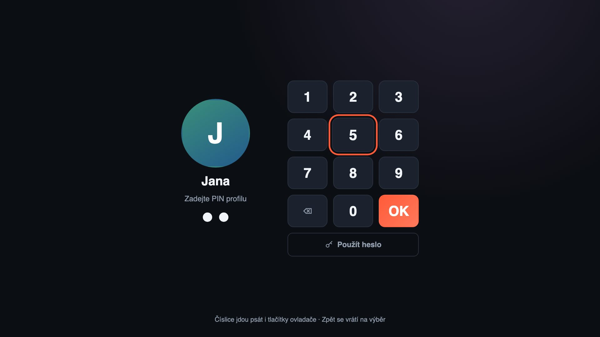

# Profile switching

Status: implemented in 0.7.104; the behaviour as shipped is described in
[users.md](users.md#switching-profiles). Decided with the owner on 2026-11-14. The execution order is in
[profile-switching-agent-task.md](profile-switching-agent-task.md); the visual
study is in [profile-switching-prototype](profile-switching-prototype/README.md).
Where the prototype disagrees with this document, this document wins.

## Goal

A household shares a television, a tablet and a browser. Today, changing who is
watching means signing out and typing a name and a password, and on Android TV
pairing the device again from a phone. Let a signed-in device change to another
household account in a few seconds, with a PIN where the administrator wants
one, without weakening what an account protects.

## Decisions

| Question | Decision |
| --- | --- |
| What is a profile? | **An existing account.** No profiles under an account, no second key in personal data. "Profile" is only the word the switcher uses. |
| Who can switch, and to whom? | The administrator marks accounts as **in the profile switcher**. That one mark works both ways: the marked accounts see each other and can switch among themselves. An account without it — a friend's, a guest's — sees no profiles and cannot switch at all. Off for every existing and new account. |
| What does entering a profile take? | Per account: **nothing**, a **PIN**, or the **password**. The default is the password. An administrator account can never be entered with nothing. |
| What does a device show when it starts? | The account that was last active on it, as today. There is no "Who is watching?" screen and no household-device token. |
| Kids mode | Out of scope. It comes after this and builds on it. |

## What already exists

Read [users.md](users.md) first. The parts this design leans on:

- Everything personal is keyed by the account id: `UserData` in the state
  file, follows, downloads, activity, media-server state. Grants to libraries
  and addons and the two download permissions are per account.
- A session is a signed ticket naming the account, signed with that account's
  own secret (`server/src/auth.ts`). A device holds exactly one: the browser in
  the `stremio_offline_session` cookie, the TV app in `SessionStore`.
- Signing out revokes the session id and stops what that session holds open
  (`stopOwnedPlayback`). Withdrawing access re-checks in flight
  (`server/src/revocation.ts`).
- Ordinary accounts reach only the routes in `USER_ALLOWED`
  (`server/src/roles.ts`); restricted mode allows only the writes in
  `ALLOWED_MUTATIONS` (`server/src/restricted.ts`).
- Accounts stay in `state.json`; a write there rewrites the file.

## Security model

1. **A PIN never opens the instance to a device that is not signed in.** The
   profile list and the switch are behind the ordinary sign-in gate. The
   sign-in screen is unchanged and knows nothing about PINs. Guessing a PIN
   from the internet therefore first needs a household password.
2. **The server decides.** The PIN is checked on the server and the answer is
   a new session for the target account. No client keeps another account's
   ticket, PIN or password, and no overlay in a client counts as protection.
3. **The device ends up holding only the target account's session.** The
   previous session is revoked and its playback and device transfers are
   stopped, exactly as a sign-out of that one device does.
4. **A switch does not extend the sign-in.** The new session expires when the
   previous one would have. Every device still needs a password or a pairing
   once per sign-in period.
5. **Attempts are counted per target account**, not per address: behind a
   reverse proxy the whole household shares one address, and four digits are
   only 10,000 guesses.
6. **The switcher is a closed group the administrator chooses.** Only an
   account in it may list profiles or switch, and only to another account in
   it. Having an account on the instance is not enough: somebody given an
   account as a guest learns no names and enters nothing. To everybody, an
   account outside the group is answered exactly like one that does not exist.

A PIN is a convenience between people who share a living room. It is not a
parental boundary on its own: a child who watches a parent type four digits has
them. That is why the administrator's account defaults to the password and why
the unlock method is chosen per account.

`unlock: "none"` means what it says: any member of the group, on any device
they are signed in on, enters that profile. A stricter rule — the first entry
on each device takes the password, and a PIN or nothing works only after
that — was considered and deferred; see [Not in this design](#not-in-this-design).

## Data model

Three optional fields on `UserRecord` (`server/src/users.ts`). Absent fields
mean today's behaviour, so no migration and no `schemaVersion` bump.

| Field | Meaning |
| --- | --- |
| `switcher?: boolean` | The account is in the switcher group: it is offered to the other members and may itself switch. |
| `unlock?: "none" \| "pin" \| "password"` | What entering it from the switcher takes. Absent means `"password"`. |
| `pinHash?: string` | scrypt hash of the PIN, the same scheme as `passwordHash`. Never leaves the server. |

Rules, enforced on the server at every write:

- A PIN is 4 to 8 ASCII digits.
- `unlock: "pin"` requires a stored PIN. Removing the PIN while the method is
  `"pin"` sets the method back to `"password"`.
- `unlock: "none"` is refused for an administrator. Promoting an account whose
  method is `"none"` sets it to `"password"` in the same write.
- Changing these three fields does not bump `permissionsVersion` and signs
  nobody out: they change how a profile is entered, not what an account may do.
- Deleting an account removes them with the record. Disabling keeps them.

`PublicUser` gains `switcher: boolean`, `unlock` (the effective value) and
`hasPin: boolean`.

## API

All paths are under `/api`. Every response of the two `/profiles` routes
carries `cache-control: private, no-store`.

### `GET /profiles`

For any signed-in account. Lists the switcher group as this session sees it.
A caller that is not in the group gets an empty list.

```json
{ "profiles": [
  { "id": "usr_1a2b3c4d", "username": "Jana", "unlock": "pin", "current": false, "pinLocked": false },
  { "id": "usr_5e6f7a8b", "username": "Ondra", "unlock": "password", "current": true }
] }
```

- For a caller with `switcher: true`: the accounts with `switcher: true` that
  are enabled and do not owe a password change, the caller's own among them
  with `current: true`.
- For any other caller: `{ "profiles": [] }`, the same answer an instance
  with no group gives.
- Order: the order of the account list, which is creation order.
- `pinLocked` is present for `unlock: "pin"` and true while the PIN is locked
  (see [attempt limits](#attempt-limits)); the client then asks for the
  password.
- In restricted mode the list is empty.
- Nothing else about an account is disclosed: no role, no last-seen time, no
  PIN length.

### `POST /profiles/switch`

Body: `{ "id": "usr_…", "pin"?: "1234", "password"?: "…" }`.

1. The caller needs a valid session that does not owe a password change.
2. The caller must be in the group, and the target must be in the caller's
   `GET /profiles` list and not be the caller. Otherwise
   `404 err.profileUnavailable`, whatever the reason: a caller outside the
   group cannot tell a member from an account that does not exist.
3. If the attempt limit says wait: `429 err.tooManyAttempts` with
   `retry-after`, before any secret is checked.
4. Check the secret:
   - `unlock: "none"`: nothing to check.
   - `unlock: "pin"`: `pin` against `pinHash`. A wrong PIN is
     `401 err.badPin`. A locked PIN is `403 err.pinLocked`.
   - `unlock: "password"`: `password` against `passwordHash`. Wrong is
     `401 err.badCredentials`.
   - **A correct `password` is accepted for every method**, and it is the only
     thing accepted while the PIN is locked. It is the same credential the
     sign-in screen takes.
5. On success, inside one `store.update` that re-reads both accounts:
   - re-check that the caller is still in the group and that the target is
     still listed, enabled, not owing a password change and that its secret
     is the one the hash was checked against;
   - add the caller's session id to the caller's `revoked` ledger;
   - set the target's `lastSeenAt`.
6. Issue a session for the target signed with the target's secret, with the
   **expiry of the caller's session**, and send it in `set-cookie` with
   `Max-Age` equal to the time left.
7. After the write: `stopOwnedPlayback(oldSid)` and
   `forgetMediaPlayback(oldUserId)`.
8. Answer `200` with the body of a sign-in:
   `{ "username", "role", "language", "mustChangePassword": false }`.

One state write per successful switch; a failed attempt writes nothing.

### `PATCH /auth/pin`

The signed-in account sets or removes its own PIN.
Body: `{ "currentPassword": "…", "pin": "1234" | null }`.
A wrong password is `err.wrongCurrentPassword`. Setting a PIN does not change
the unlock method; that stays the administrator's choice. Removing it applies
the fallback rule above. Clears the attempt counter for this account.

### Administrator routes

- `PATCH /users/:id` additionally accepts `switcher` (boolean) and `unlock`.
  Validation as in [Data model](#data-model); a violation is
  `400 err.invalidRequest`, except `unlock: "pin"` without a stored PIN, which
  is `400 err.pinRequired`.
- `PATCH /users/:id/pin` with `{ "pin": "1234" | null }` sets or removes the
  PIN of any account. The administrator never reads a PIN back. Clears the
  attempt counter and the lock for that account. Guard with `assertStillAdmin`
  inside the mutator, because the hash is awaited first.
- `GET /users` returns the three new `PublicUser` fields.

### `GET /auth/me`

Gains `canSwitch: boolean`: true when `GET /profiles` would return at least one
entry other than the caller, so always false for an account outside the group. Clients show the switcher entry only then, without
a second request on every start. Also gains `hasPin: boolean` for the caller's
own settings.

### Gates

- Add to `USER_ALLOWED`: `GET /profiles`, `POST /profiles/switch`,
  `PATCH /auth/pin`. `PATCH /users/:id/pin` stays administrator-only by
  absence.
- Add nothing to `ALLOWED_MUTATIONS`: in restricted mode a switch and a PIN
  change are refused by the existing gate.
- Add nothing to `MUST_CHANGE_ALLOWED` or `OPEN_PATHS`.
- Put the two `/profiles` routes and `/auth/pin` behind `authLimit`.

### Errors

New catalogue keys in `server/src/errors.ts`, `web/src/i18n/en.ts` and
`cs.ts`: `err.profileUnavailable`, `err.badPin`, `err.pinLocked`,
`err.pinRequired`, `err.pinFormat`.

## Attempt limits

In memory only, keyed by the **target account id**, shared by every device.
Model it on `LoginThrottle`; do not persist it. A restart clears it, which is
accepted: nobody who can restart the server needs to guess a PIN.

- The first 5 failures cost nothing.
- From the 6th, the next attempt on that account has to wait: 30 s, doubling,
  capped at 15 min. This applies to PIN and password attempts alike.
- After 10 failures without a success the **PIN is locked**: the profile takes
  only the password until that account signs in or switches with its password,
  or an administrator sets a new PIN.
- A success clears the counter.
- Failures through the sign-in screen keep their own per-address throttle and
  do not feed this one. A successful password sign-in for the account clears
  its PIN lock.

Somebody in the household can lock a relative's PIN on purpose. The cost is
typing a password once; say so in the documentation.

## Logging

One line each, with names and ids as the account routes already log them:
`Profile switch` (from, to, method), `Failed profile switch` at `WARN` (from,
to, method, never the value tried), `PIN locked` at `WARN`, `PIN set` and
`PIN removed` (actor, target), `Profile switcher changed` (actor, target,
switcher, unlock). Never log a PIN or its length.

## Web and desktop

The desktop app is the web interface; it needs nothing of its own.

### Entry points

Shown only when `canSwitch` is true.

- **Wide layout:** the account name in the top bar becomes a button that opens
  the switcher. Sign out stays beside it.
- **Compact layout (phone, small tablet):** a **Switch profile** item in the
  More menu, directly above **Sign out**.

### The switcher dialog

The standard dialog shell from [ui-conventions.md](ui-conventions.md): head
with a title and an X, a scrolling body, `dialog-foot`. No bottom sheet, no
one-off full-screen takeover. On a phone the shell already fills the screen
from the top.

1. **Choose.** One row per profile: an initial in a circle, the name, and on
   the right what it takes (a lock for a PIN, a key for a password, nothing
   for none). The current account is marked and not selectable. Rows are at
   least 56 CSS pixels high. A profile with `unlock: "none"` switches on the
   tap.
2. **Unlock.** The chosen name stays in the head with a back arrow. One field:
   - PIN: `type="password"`, `inputmode="numeric"`, `pattern="[0-9]*"`,
     `autocomplete="off"`, `maxlength="8"`, drawn large with wide letter
     spacing. The system keypad is the keypad; do not draw one. Enter and the
     primary button submit; there is no auto-submit, because the length is not
     known to the client.
   - Password: the ordinary password field with
     `autocomplete="current-password"`.
   - Under a PIN field, a **Use password instead** link changes the field. A
     locked PIN goes straight to the password with a line that says why.
   - A failure is a `login-error` line in the footer and the field is cleared
     and refocused. A wait shows the seconds from `retry-after` and disables
     the primary button until they pass.



| Phone, entry in More | Phone, PIN with the keypad up | Phone, locked PIN |
| --- | --- | --- |
|  |  |  |



Phone details that have broken this interface before:

- With the keyboard up, the field, the link and the primary button must all
  stay visible in portrait at 360x640 and in landscape at 640x360. Keep the
  unlock step short enough that nothing has to scroll: name, field, one link,
  footer. Sideways there is room for one row only, so the avatar and the hint
  line go and the link moves beside the field.
- Respect `safe-area-inset-top` in the head and `safe-area-inset-bottom` in the
  footer.
- Focus the field when the step opens so the keypad comes up without a second
  tap.

### After a switch

Clear the stored Home (`clearHomeCache`) and reload the page, as sign-out does.
Nothing of the previous account is drawn before `/api/auth/me` answers for the
new one.

If the player is open or a save-to-device transfer is running, opening the
switcher first says that switching stops them and asks to confirm. The server
stops them either way.

### Settings

- **Settings -> Users -> account dialog**, on the Account tab under the
  password, a **Profile switching** block:
  - a switch **In the profile switcher**, with a line under it: *Accounts in
    the switcher see each other and can switch among themselves. Leave it off
    for a guest.*;
  - **To open this profile**: a select with *Nothing*, *PIN*, *Password*.
    *Nothing* is absent for an administrator. Disabled while the switch above
    is off;
  - **PIN**: a state line (*No PIN* / *PIN is set*) with **Set PIN** and
    **Remove**. Setting it is a 4 to 8 digit field in place; the administrator
    cannot read an existing one;
  - a hint that says a PIN protects against a slip, not against somebody who
    watched it being typed.
  The user list shows a small marker on accounts that are in the switcher.
- **Settings -> Account**: **Profile PIN** for the signed-in account: set,
  change or remove, each asking for the current password. Shown only to an
  account that is in the switcher; a PIN is of no use to any other.



All strings go through `web/src/i18n/en.ts` and `cs.ts`.

## Android TV

- **Entry point:** the account item in the rail keeps opening Settings. The
  Settings screen gains **Switch profile** above **Sign out**, shown when
  `canSwitch` is true. Long-pressing the account item in the rail opens the
  switcher directly.
- **Switcher screen:** full screen, a horizontal row of round avatars with the
  name under each and a lock or key badge. D-pad left and right move, OK
  chooses, Back closes. Focus uses the orange focus treatment the carousels
  use. The current profile is drawn dimmed, is marked, and is skipped by focus.
- **PIN:** a 3x4 on-screen number pad (1 to 9, delete, 0, confirm) driven by
  the D-pad, with one dot per digit entered and no empty placeholders, since
  the length is not known. Number keys on a remote or
  keyboard type directly, DEL deletes, Enter confirms. Focus starts on 5 so
  every digit is at most two moves away. Back returns to the row.
- **Password:** the existing text field and system keyboard, as on the sign-in
  screen, reached from a **Use password** button under the pad or directly for
  a password profile or a locked PIN.
- **After a switch:** the response's `set-cookie` replaces the stored session
  through the existing `CookieStore`. `SessionViewModel` moves to a new
  signed-in state built on a new `ApiClient`, so the session-scoped view-model
  store, the image cache key and the locale are all rebuilt, as after a
  sign-in. Playback is stopped first.
| Choose | PIN |
| --- | --- |
|  |  |

- Compatibility as for every TV change: `minSdk` stays, and it has to work on
  API 28 and API 31 with a remote only. Strings come from the web catalogue
  through `strings.keys`.

## Not in this design

- A profile chooser at start-up, and remembering a device as belonging to the
  household after sign-out.
- **First entry on a device by password.** A PIN or nothing would work only on
  a device where that account has already signed in with its password, proven
  by a signed record the device keeps until the password changes. It would
  stop one member entering another's profile on a device that person never
  used, at the cost of device state and of typing every password once on each
  television. Deferred by the owner on 2026-11-14 until the closed group
  proves insufficient.
- Separate rights to be listed and to switch. One mark covers both.
- Kids mode: a child policy, a simplified Home, age ratings.
- Profiles under one account, avatars or colours chosen by the user.
- Biometric unlock, PIN on the sign-in screen, PIN for single actions
  (purchases, deleting files).
- Pairing a TV straight into another account than the approving one.

## Acceptance

Server, as route tests against a real `Store`:

- an unlisted, disabled, must-change or unknown target answers the same 404;
- a caller outside the group gets an empty list, `canSwitch: false` and the
  same 404 for a member, a non-member and an unknown id, even for a member
  whose method is `none`; taking a caller out of the group between the check
  and the write refuses the switch;
- none / PIN / password each switch and each refuse the wrong secret;
- a password works for a PIN profile and for a locked PIN;
- the old session is revoked and stopped, the new one verifies with the
  target's secret and carries the old expiry;
- the 6th failure waits, the 10th locks, a password success unlocks, an
  administrator's new PIN unlocks; counting is per target, not per address;
- an administrator cannot be set to `none`; promotion repairs it; removing a
  PIN falls back to the password;
- an ordinary account reaches the three allowed routes and not
  `PATCH /users/:id/pin`; restricted mode refuses the switch and lists nothing;
- no response and no log line contains a PIN, a hash or a PIN length;
- a failed attempt performs no state write.

Web: component tests for the dialog steps, the wait state and the settings
block; one end-to-end run that switches between two accounts and proves the
second account's Home, favourites and grants are the ones shown, on the desktop
and on the phone viewport.

Android TV: instrumented D-pad tests that reach the switcher, enter a PIN with
the pad and with number keys, and land in the other account, each written to
fail before the feature exists.
