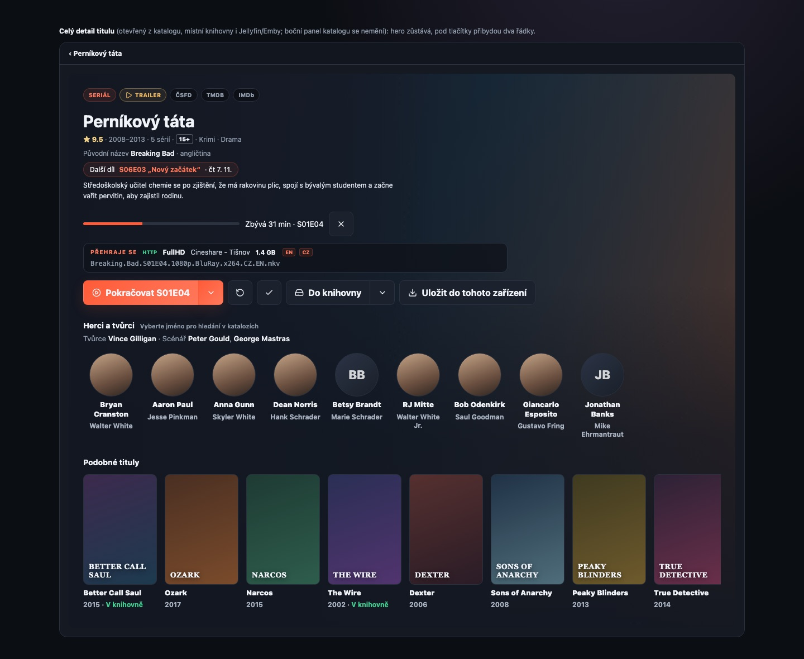
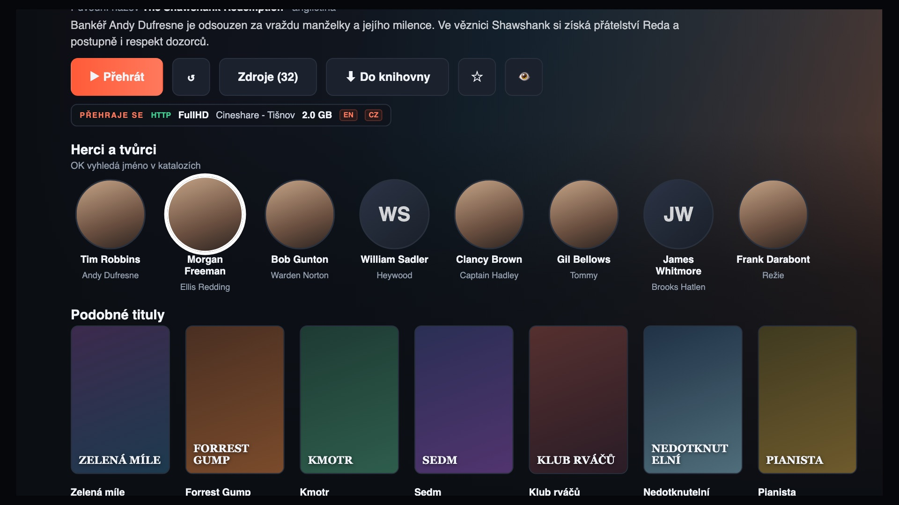

# Richer title detail

Roadmap item 1. This document is the contract for the work: what the title
detail gains on the web, the desktop apps and Android TV, where the data comes
from, and the order of the pull requests. It describes proposed behaviour;
nothing here has shipped yet.

The visual study is in [title-detail-prototype](title-detail-prototype/README.md).

## Goal

A viewer who opens a title sees who is in it and who made it, a row of
similar titles, the age rating, the original title and, for a series, when
the next episode airs, without leaving the app. Selecting a person searches
the catalogues and libraries for that name; selecting a similar title opens
its detail.

All three clients read one server answer. No client calls TMDB, and secure
mode never hands a client an upstream image address.

## Non-goals

- **No rewrite of the detail screens.** The owner rejected a unified detail
  before. The rows are added under the existing actions; the hero, the
  chips, the split buttons, the source row and the episode list keep their
  place and behaviour.
- **The catalogue's side panel stays as it is.** It is the way into the full
  detail. Its one change is the age-rating badge inside the existing facts
  line (the line with the rating, the year and the genres), and only where it
  does not push or shorten the description. Nothing in the panel is removed
  or replaced.
- No person pages, filmographies or biographies. A person is a search.
- No new metadata store. Extras are cached in memory and fetched again after
  a restart.
- Jellyfin/Emby `People` are not read in this work. A remote title gets the
  extras through its catalogue identity, the same way it already gets its
  trailer and links.
- No change to how sources, playback or downloads behave.

## What exists today

Inventory made on `main` at `24dd6761` (2026-10-31). File and symbol names,
not line numbers.

- `GET /api/meta/:type/:id` (`server/src/routes/catalog.ts`) returns the
  aggregate addon answer from `metadata()` / `fillMissingMeta`
  (`server/src/addons.ts`), cached six hours by `cachedMeta`. It already
  carries Cinemeta's `cast`, `director`, `writer` (plain name arrays, three
  actors at most), `imdbRating`, `released`, `country`, `awards`,
  `trailerStreams` and the episode `videos` with `released` dates.
- Cinemeta has **no** age rating, no original language, no person ids and no
  person photos. Only TMDB has them.
- `server/src/tmdb.ts` calls `/find`, `/movie|tv/:id`, `external_ids`,
  `images`, `videos`, `tv/:id/season/:n` and `movie/:id/release_dates`
  (`tmdbMovieReleases`, which ignores the certification). There is no call to
  `credits`, `aggregate_credits`, `recommendations` or `content_ratings`.
  The key is `store.settings().tmdbApiKey`; IMDb→TMDB resolution is the
  internal `resolveId` with the module-level `idCache`.
- `ImageProxy.rewriteMeta` (`server/src/images.ts`) proxies only `poster`,
  `background`, `logo`, `videos[].thumbnail`, `images` and `screenshots`.
  A new nested photo field would leak its upstream URL in secure mode.
- Web: the full detail is `LibraryTitleDetail` hosted by
  `CatalogueTitleDetail` (catalogue), `LocalLibraryDetail` (local library,
  identity from `/api/library/identity`) and `RemoteLibraryBrowser`
  (Jellyfin/Emby, identity from provider ids). The latter two already fetch
  catalogue metadata through `useTitleEnrichment`. The full detail does not
  show the IMDb rating, which the side panel does.
- TV: `CatalogDetailScreen` (catalogue), `DetailScreen` (local),
  `RemoteDetailScreen` (Jellyfin/Emby). `MetaDto` drops every key it does
  not name, including `cast`. `CatalogDetailScreen` is at ART's method
  register limit: growing it crashes a real device with `VerifyError` while
  JVM tests stay green.
- Search: web `App.openSearch()` takes no query; TV `SearchPreset` has no
  query. Neither can be opened pre-filled from another screen.

## Design

### Web and desktop: the full detail



Top to bottom, inside the existing `library-title-detail` surface:

1. **Chips row** — unchanged.
2. **Title and facts line** — the facts line gains the IMDb rating at its
   front (as the side panel already shows it) and the age-rating badge at its
   end. Each host keeps its own facts (catalogue: year and genres; local:
   year and size; remote: year and runtime). Nothing in it is removed.
3. **Original title line** — `Původní název <b>…</b> · angličtina`, only when
   the original title differs from the displayed name or the original
   language differs from the interface language. One line, muted. The
   language name comes from `Intl.DisplayNames` in the interface language
   (the app's `label()` gives only codes such as `EN`).
4. **Next episode pill** (series only) — `Další díl S06E03 „…“ · čt 7. 11.`
   when a future episode is known; nothing otherwise. Works with or without
   a TMDB key.
5. **Description** — unchanged.
6. **Saved position and the row that will play** — unchanged in content and
   order. The row is made readable: a `Přehraje se` label, more contrast, and
   the release name (`behaviorHints.filename` or the stream title) on its own
   line, ellipsised. This is the only restyle of an existing element.
7. **Actions** — unchanged: Přehrát with its source chooser, Přehrát od
   začátku, Zhlédnuto, Do knihovny with Uložit jinam…, Uložit do tohoto
   zařízení, and whatever the host adds.
8. **Herci a tvůrci** (new) — a one-line crew summary (`Režie`, `Tvůrce`,
   `Scénář`, `Předloha`, each name a link) and a horizontal strip of round
   portraits with the name and the character. A missing photo shows the
   initials. Up to 20 cast portraits; the crew line holds up to 8 names.
9. **Podobné tituly** (new) — a horizontal strip of poster tiles with the
   name and year. A title the viewer already has in a library says
   `V knihovně`. Up to 12 titles. Hidden when there are none.

Both rows load after the hero, show a skeleton while they load, and are
simply absent when the answer is empty or failed — no error message. Without
a TMDB key the cast row shows the addon's names without photos and the
similar row is not drawn.

Selecting a person closes the detail and opens Search with the name as the
query, already submitted (Search everywhere, or the older catalogue search
where the instance runs that one). Selecting a similar title opens its
catalogue full detail; Back returns to the title the viewer came from: the
app keeps a stack of up to ten previous catalogue titles.

A Jellyfin/Emby **series** does not use this surface today (it has its own
hero and episode grid); there the two rows go under the episode grid.

On a phone the same rows stack under the actions, with 62 px portraits and
108 px tiles, scrolling sideways.

### Catalogue side panel

Only the age-rating badge, appended at the end of the existing facts line.
The description, the sources and the buttons do not change. The panel reads
the badge from `/extras`, whose cache keeps a catalogue browse from asking
TMDB again for a title it has seen.

### Android TV



- The screen opens exactly as today. Under the action row (a film) or under
  the episode row (a series) come the same two rows: `Herci a tvůrci` with
  round portraits and `Podobné tituly` with poster cards.
- DOWN from the last row of the current screen moves into `Herci a tvůrci`;
  the whole content column scrolls up so the focused row is fully visible
  (the hero and the action row scroll away above it). UP returns the same
  way and the column scrolls back.
- The focused portrait or poster gets the white focus ring and the scale the
  other TV cards use.
- OK on a person closes the detail overlay and opens the global search with
  the name as the query, started. OK on a similar title opens its catalogue
  detail; Back returns to this title (a stack of up to ten) with the focus
  on the card that was opened.
- The facts line gains the age-rating badge; the original title line and the
  next-episode pill appear as on the web. The chosen-source caption stays
  where it is today (under the action row) and gets the same `Přehraje se`
  label and contrast as the web row.
- The rows are new composables in their own file; `CatalogDetailScreen` only
  calls them. See [the TV constraint](#android-tv-implementation).

## Data contract

### `GET /api/meta/:type/:id/extras`

Query: `language` (as `/api/meta`). Same authentication as `/api/meta`.

```ts
interface TitleExtras {
  /** Cast first in billing order, then crew; at most 20 cast and 8 crew. */
  people: TitlePerson[];
  /** At most 12, each openable as a catalogue title. */
  related: RelatedTitle[];
  /** As written on the certification, e.g. "12", "PG-13", "TV-MA". */
  ageRating?: string;
  /** The ISO 3166-1 region the rating belongs to ("CZ", or "US" after the fallback);
   *  the badge's tooltip names it. */
  ageRatingRegion?: string;
  /** Whenever TMDB knows it. The client decides whether it differs from the
   *  name it shows, since that name depends on the viewer and the screen. */
  originalTitle?: string;
  /** ISO 639-1, from TMDB. */
  originalLanguage?: string;
  /** The episode with the earliest valid release date after now, from the
   *  meta's videos; season 0 (specials) and unparseable dates are ignored. */
  nextEpisode?: { season: number; episode: number; name?: string; released: string };
  /** Where people and related came from, for the client's empty states. */
  source: "tmdb" | "addon";
}

interface TitlePerson {
  name: string;
  role: "cast" | "director" | "creator" | "writer" | "novel";
  /** The character for cast, the job for crew. */
  character?: string;
  /** Proxied in secure mode, like every other picture. */
  photo?: string;
}

interface RelatedTitle {
  type: "movie" | "series";
  /** An IMDb id (`tt…`), so every client opens it as any catalogue title. */
  id: string;
  name: string;
  year?: string;
  poster?: string;
  /** True when the viewer can see a library copy of it. */
  inLibrary?: boolean;
}
```

The answer is always 200 with whatever was found. A title nobody knows
answers `{ people: [], related: [], source: "addon" }`.

### Where each field comes from

| Field | With a TMDB key | Without |
| --- | --- | --- |
| `people` | `credits` (film) / `aggregate_credits` (series), photos `w185` | the meta's `cast`, `director`, `writer` names, no photos |
| `related` | `recommendations`, each resolved to IMDb through `external_ids`; titles without an IMDb id dropped; at most 16 lookups to find 12 | empty |
| `ageRating` | film: `release_dates` certification for the region, else `US` (per region the first non-empty one, preferring release type 3, then 4, 5, 6, 2, 1); series: `content_ratings[].rating` for the region, else `US` | absent |
| `originalTitle`, `originalLanguage` | TMDB detail `original_title`/`original_name`, `original_language` | absent |
| `nextEpisode` | the meta's `videos` | the meta's `videos` |

The region is the country of the interface language after
`normalizeLanguage` (`cs` → `CZ`, `sk` → `SK`, `en` → `US`, `de` → `DE`,
`pt` → `BR`, …). One detail request per title:
`/movie/:id?append_to_response=credits,recommendations,release_dates` or
`/tv/:id?append_to_response=aggregate_credits,recommendations,content_ratings`
(a series' creators come from the detail's own `created_by`). Besides it:
`/find` when the IMDb→TMDB id is not cached yet, and `external_ids` per
related row. Worst cold open: 1 + 1 + 16 requests; a warm one: none.

### Server rules

- A new module `server/src/title-extras.ts` builds the answer; the route is
  registered beside `/api/meta` in `routes/catalog.ts`. `/api/meta`'s answer
  and its six-hour cache do not change.
- Cache: only the TMDB part is shared — in memory, keyed by type, id,
  language and a fingerprint of the TMDB key (so a replaced key never reuses
  the old key's failures, and no key means no TMDB part at all), 24 hours, at most 500 titles; failures are cached for 10 minutes
  so a dead TMDB is not asked on every open. Everything that depends on the
  viewer is computed per request and never written into the cached object:
  the addon fallback (it comes from the viewer's own addons), `nextEpisode`
  (from the viewer's six-hour `cachedMeta`) and `inLibrary`.
- Concurrent requests for the same title share one TMDB fetch (an in-flight
  map). The related lookups run at most four at a time; a failed
  `external_ids` drops that one title only, never the people or the rating.
  Every TMDB call keeps the module's existing timeout.
- `inLibrary` is `localCopies(type, id, viewer)` (already filtered by
  `visibleLibraries`) — never another account's view. Local libraries only;
  Jellyfin/Emby copies do not count in this work.
- Secure mode: `ImageProxy` gets `rewriteExtras(extras)`, which proxies every
  `people[].photo` and `related[].poster`. The route always returns the
  rewritten answer.
- The fallback without a key reads the viewer's own `cachedMeta`, so it never
  shows names from an addon the viewer may not use.
- A TMDB 401, 404, 429 or transport failure answers the addon fallback and
  logs the way `tmdbMeta` does, never with the key.

### Clients

- **Web:** `api.titleExtras(type, id, language)`; a `TitleExtrasRows`
  component (`web/src/TitleExtras.tsx`) that `LibraryTitleDetail` renders
  under its actions through a new optional prop, so the three hosts pass the
  identity they already know (catalogue target, `/api/library/identity`'s
  `bound`, the remote title's catalogue identity). A session cache with a
  lifetime: an answer with `source: "addon"` is kept 10 minutes, any other
  one hour, a failure not at all; the cache is emptied when the signed-in
  account changes and whenever the app learns that a library changed (a
  finished download, a library operation, a rescan), so `V knihovně` is not
  left behind. The next-episode pill is filtered at render time against the
  current clock and re-checked every minute, so an episode that has aired
  disappears from an open detail. The client shows the original-title line only when
  `originalTitle` differs from the name on screen (trimmed, case-insensitive)
  or `originalLanguage` differs from the interface language.
- **Search entry:** `App.openSearch(query?: string)`; with a query it closes
  the catalogue detail, sets the Search everywhere draft and submits it.
- **TV:** `TitleExtrasDto` in `data/`, `TvApi.titleExtras`, and composables in
  `ui/detail/TitleExtras.kt`. `SearchPreset` gains `query: String?`; the shell
  clears the detail overlay (otherwise `OverlayFocusTrap` keeps it on top of
  Search) and opens `GlobalSearchScreen`, which submits a preset query. The
  shell's single `catalogDetail` slot gains a back stack for related titles.

### Strings

New keys in every web catalogue (`en.ts` is the source; `cs.ts` and the
other eight are typed against it) and in every TV `values*/strings.xml`:

| Key | English | Czech |
| --- | --- | --- |
| `detail.people` | Cast and crew | Herci a tvůrci |
| `detail.peopleHint` | Select a name to search for it | Vyberte jméno pro hledání v katalozích |
| `detail.related` | More like this | Podobné tituly |
| `detail.role.director` | Director | Režie |
| `detail.role.creator` | Created by | Tvůrce |
| `detail.role.writer` | Writer | Scénář |
| `detail.role.novel` | Novel | Předloha |
| `detail.originalTitle` | Original title {title} | Původní název {title} |
| `detail.nextEpisode` | Next episode {episode} · {date} | Další díl {episode} · {date} |
| `detail.ageRating` | Age rating {rating} | Věková hranice {rating} |
| `detail.inLibrary` | In a library | V knihovně |
| `detail.searchPerson` | Search for {name} | Hledat „{name}“ |
| `detail.willPlay` | Will play | Přehraje se |

TV string names follow the existing `snake_case` resource style
(`detail_people`, …). Plurals are not needed.

## Delivery plan

One branch and one pull request for the whole chain, slices committed in
order; screenshots and the UX pass once, at the end.

| Slice | What | Main files | Tests that must exist |
| --- | --- | --- | --- |
| 1 | Server: `/extras`, TMDB appends, certification by region, related → IMDb, cache, `rewriteExtras`, `inLibrary` | `title-extras.ts`, `tmdb.ts`, `images.ts`, `routes/catalog.ts` | movie and series from TMDB fixtures; no key → addon names; TMDB 401/429/down → fallback and cached failure; **an invalid key replaced by a valid one asks TMDB again at once; a removed key answers the addon fallback although a TMDB success is cached**; concurrent requests share one fetch; one failed related lookup drops only that title; secure mode proxies every photo/poster; `inLibrary` only for granted libraries and never inherited by another viewer; region fallback to US with `ageRatingRegion` |
| 2 | Web: rows, hero facts (rating, age, original title, next episode), readable source row, person → search | `TitleExtras.tsx`, `LibraryTitleDetail.tsx`, the three hosts, `App.tsx`, `api.ts`, `style.css`, i18n | rows render and hide on empty/failure; skeleton; person click submits search; related click opens detail and Back returns; side panel unchanged except the badge; client cache TTLs, cleared on account change and on a library change; an aired next episode disappears without reopening |
| 3 | TV catalogue detail: DTO, rows, focus path, source row, search with query | `TitleExtras.kt`, `CatalogDetailScreen.kt` (calls only), `SearchPreset.kt`, shell | Compose tests for DOWN/UP between actions, episodes and rows; OK on a person opens search with the query; Back restores focus; **APK launched on the emulator** (VerifyError) |
| 4 | TV local and remote detail | `DetailScreen.kt`, `RemoteDetailScreen.kt` | same rows for a bound local title and an identified remote title; nothing for an unidentified one |
| 5 | Docs and finish | `docs/playback.md` or `libraries.md` note, roadmap | screenshot baselines through the workflow; version bump |

### Android TV implementation

`CatalogDetailScreen` must not gain locals or state: the rows, their focus
requesters, their loading state and the column's scroll state live in a
holder class from `TitleExtras.kt` (or inside the existing `DetailFocus`
holder), created by one call; the content column becomes scrollable through
a modifier built from that holder, not new branches. The existing DOWN
handler hands over to the holder's first requester when the focus is on the
last row it already knows (actions for a film, episodes for a series). Every TV slice ends with the debug APK
launched on an emulator (`-cores 2 -memory 2048`, one at a time), since only
a device shows the register-limit crash.

## Acceptance

- A film and a series with a TMDB key show photos, characters, a crew line,
  similar titles, the age rating and the original title on web, desktop and
  TV; a series with an upcoming episode shows its date.
- Without a TMDB key the cast row shows the addon's names and a series still
  shows its next episode; nothing else new appears and no error is shown.
- In secure mode no response from `/extras` contains an `http(s)://` image
  address.
- The catalogue side panel looks as before apart from the badge; the full
  detail keeps every existing button and the source row.
- A person opens a search for that name on web and TV; a similar title opens
  and Back returns.
- A local file bound to a title and a Jellyfin/Emby title with an IMDb or
  TMDB id show the same rows; an unidentified one shows none.
- Navigation edge cases are tested: a related title with no cast, a title
  where both rows are empty, Back from a related title into a local or
  remote library detail, and the selected episode, scroll position and (TV)
  focus restored after Back.
